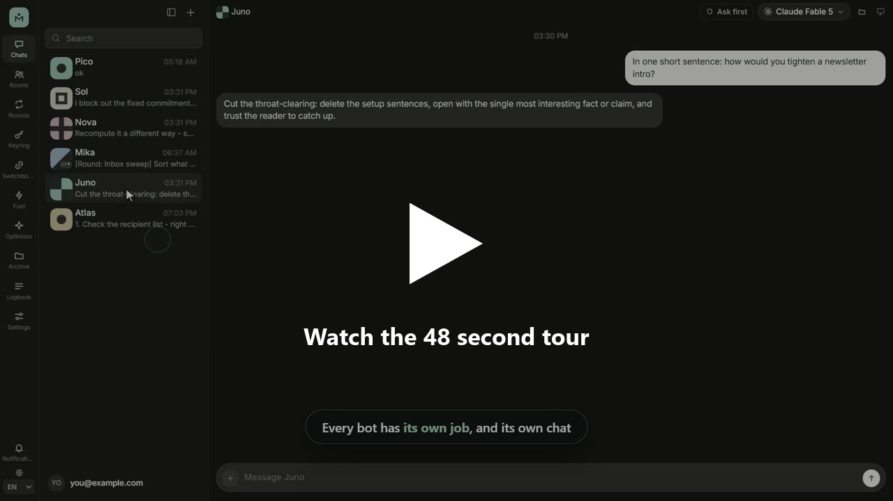
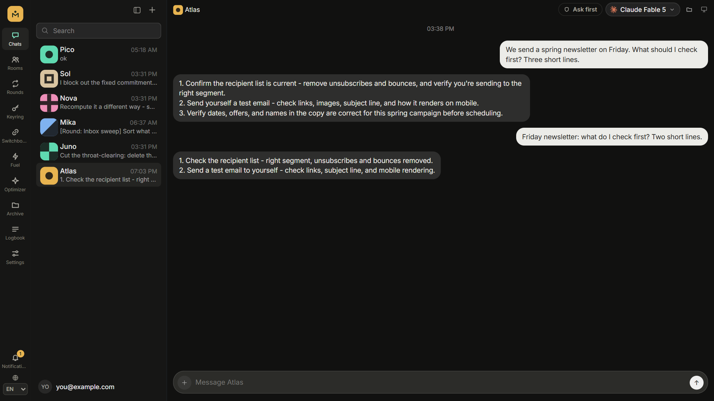
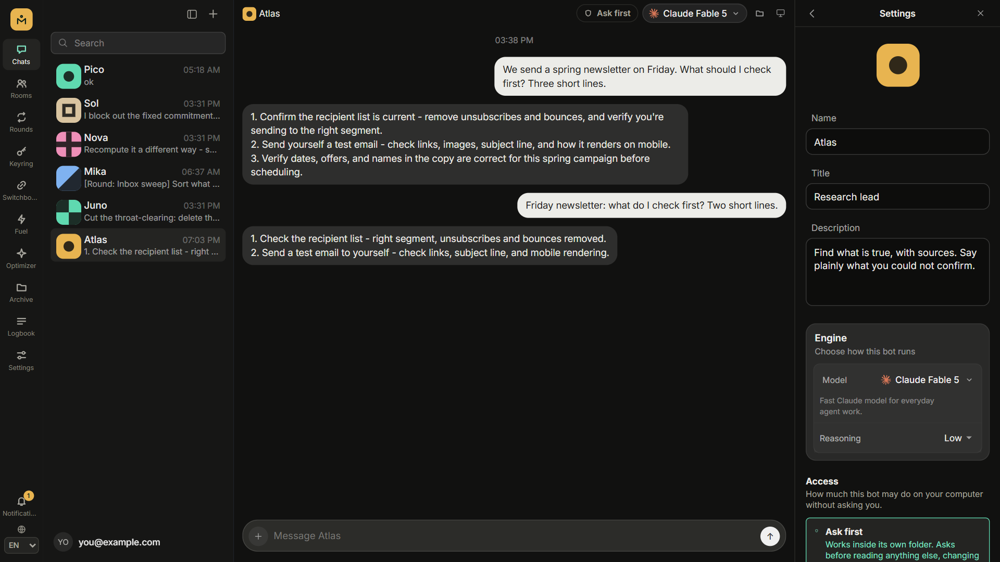
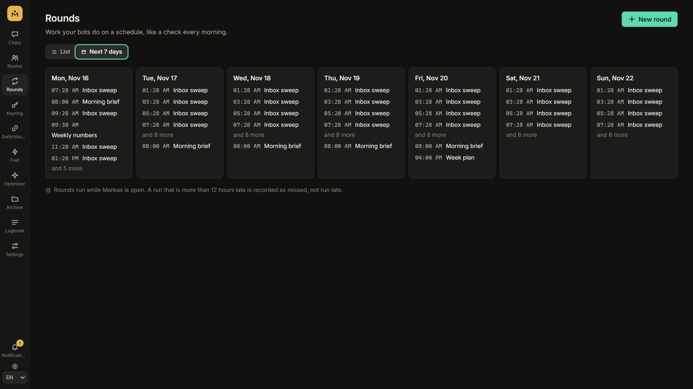
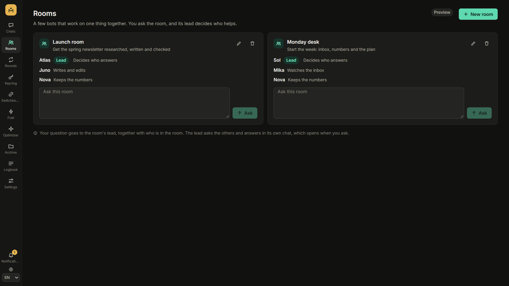
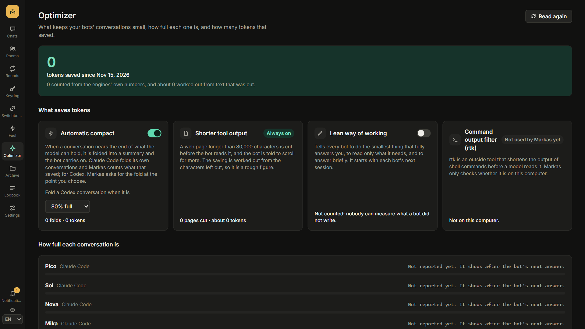
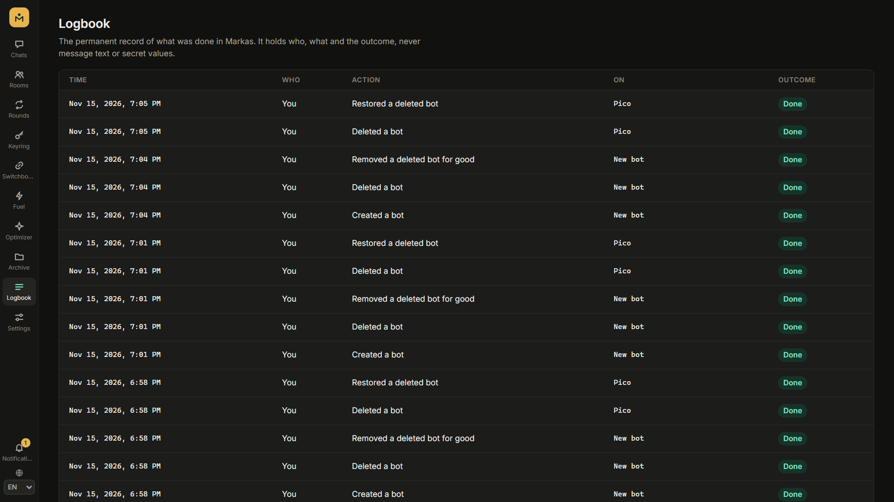

# Markas

Markas is a headquarters for your AI teammates.
It runs on your own computer, drives bots through the Claude Code and Codex tools you already use, and gives you one place to talk to them, queue work and see what each one is doing.

> [!WARNING]
> Markas is an early preview (version 0.1.0).
> A new bot asks before it acts outside its own folder, but a bot you give full access can change and delete files on your computer.
> Run only bots and tasks you trust.
> Parts marked Preview in the app work end to end but are not finished.

## See it

[](https://github.com/avelixio/markas/releases/download/v0.1.0/markas-tour-0.1.0.mp4)

The tour is recorded from the running app, with sound.
Its narration is read by Kitten TTS (KittenML).

| | |
| --- | --- |
|  Chats: every bot has its own job and its own conversation |  Access: a new bot asks first |
|  Rounds: work that runs on a schedule |  Rooms: a team on one question |
|  Optimizer: smaller conversations |  Logbook: what happened, written down |

## What it does today

- Guided setup: pick a language, check your engines, and create a first bot by answering a few questions or from a ready-made bot file.
- Create bots, each with its own name, role, model, sigil and working folder.
- Chat with a bot in its own persistent conversation.
- Queue messages while a bot is busy, then pause, resume or cancel them.
- Attach files, get files back, and browse a bot's folder in the Files panel.
- Choose how much each bot may do: ask first, read freely, or full access.
- Rounds: work that runs on a schedule, with a view of the next 7 days.
- Rooms (Preview): put a question to a team, and its lead decides who helps.
- Let bots message each other and reply.
- A browser for bots, held to the sites each bot is allowed, that hands over to you for a step only you can do.
- Keep logins in the Keyring: each key has its own name and one exact website, so two sites under one company domain never share a login.
- Switchboard (Preview): see which engines are installed and signed in.
- Optimizer: smaller conversations and a count of the tokens saved.
- Logbook: a record of what was done, by whom, and how it ended.
- Notifications for what waits on you, and Undo for a deleted bot, which can be restored for 30 days.
- Start at login and keep running in the background.
- Tell you when the window loses the host, and reconnect by itself.
- Use Markas in English or Bahasa Indonesia.

The full list, with what is finished and what is not, is in [`docs/features.md`](docs/features.md).

Everything stays on your computer.
There is no Markas account, cloud backend or telemetry.
Your bots still reach the services their engines use, such as Anthropic and OpenAI.

## Where it is going

| Area | What is planned |
| --- | --- |
| Rooms | A conversation, memory and rounds of their own for each room |
| Presence | An always-on-top signal strip that tells you when a bot needs you while the window is hidden |
| Switchboard | Checking whether a saved website login still works |
| Keys in use | A live view of which bot is using which key |
| Fuel | Moving bots to a backup engine when one runs out of plan |
| Packages | Signed installers for Windows and macOS, so neither system warns when you open them |

The interface designs live in [`design/`](design).

## Get it

1. Download the file for your system from [Releases](../../releases).

| System | File |
| --- | --- |
| Windows (64-bit) | `Markas-Setup-<version>.exe` |
| Mac with Apple silicon (M1 and newer) | `Markas-<version>-mac-arm64.dmg` |
| Mac with an Intel chip | `Markas-<version>-mac-x64.dmg` |
| Linux (64-bit) | `Markas-<version>-linux-x86_64.AppImage` |

2. Install and sign in to at least one engine: Claude Code or Codex.
3. Open Markas.

The packages are not signed with a paid certificate yet, so each system asks once before it opens Markas:

- **Windows** may show "Windows protected your PC": choose More info, then Run anyway.
- **macOS** says Apple could not verify Markas: open System Settings, go to Privacy & Security, and choose Open Anyway next to Markas.
If that button does not appear, run `xattr -dr com.apple.quarantine /Applications/Markas.app` in Terminal.
- **Linux**: make the file runnable first with `chmod +x Markas-*.AppImage`.

The macOS and Linux packages are built and started automatically on those systems, but have had less hands-on use than the Windows one.

Markas opens in its own window.
Closing the window keeps it running in the tray, so your bots carry on; choose Quit Markas from the tray icon to stop it.

### Without the desktop app

The same release has a `markas` program for servers and scripts.
Unzip it, keep the `ui` folder next to it, and run `markas`.
On macOS and Linux run `chmod +x ./markas` first.

| Command | What it does |
| --- | --- |
| `markas` | Start Markas and open its window |
| `markas open` | Open the window again, signed in |
| `markas status` | Show whether Markas is running and which engines are ready |
| `markas send <bot> "text"` | Queue a message for a bot from a script |
| `markas install` | Start at login and keep running |
| `markas uninstall` | Remove the login item |
| `markas serve` | Run without opening a window |

## Privacy and safety

- Markas listens on your own computer only, at 127.0.0.1.
- Every request needs a secret token that is created on first run and stored in `~/.markas/token`.
- Requests from other websites are refused.
- Everything Markas stores is under `~/.markas/`.

## Build from source

This is only for changing the code; the download above needs none of it.
You need [Bun](https://bun.sh) 1.3.11 or newer.

```bash
bun install
bun run build:ui
bun src/host/cli.ts    # start Markas and open it
bun run check          # lint, typecheck, tests, UI build
bun run package        # build the downloadable zips into dist/release/
bun run desktop        # run the desktop app from source
bun run package:desktop  # build the desktop installer into dist/desktop-release/
```

The engine tests use POSIX shell scripts, so the full suite runs on macOS and Linux.
On Windows, run it inside WSL.

| Folder | What is in it |
| --- | --- |
| `src/host/` | The host: HTTP API, event stream, commands, login item |
| `src/desktop/` | The desktop app: a thin shell that starts the host and shows its window |
| `src/backend/` | Bots, conversations, queues and the engine clients |
| `src/renderer/` | The web interface |
| `design/` | The interface design, generated from source into a FigCraft file |
| `docs/adr/`, `docs/bdr/` | Decision records |

## Licence and acknowledgements

Markas is licensed under Apache-2.0.
See [LICENSE](LICENSE) and [NOTICE](NOTICE).

Inspired by OpenBot.
